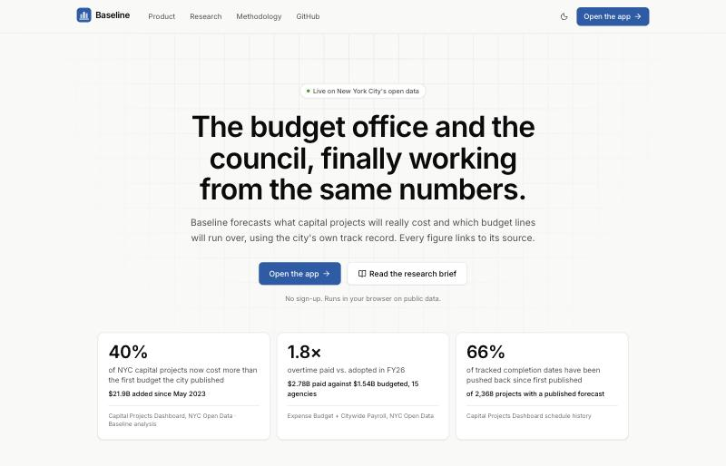
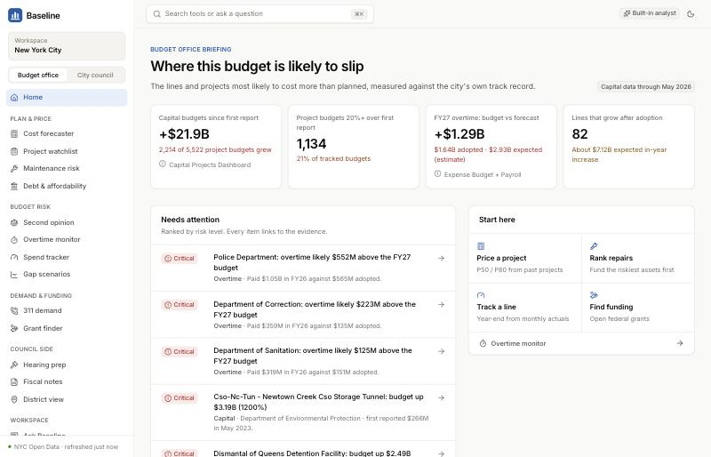
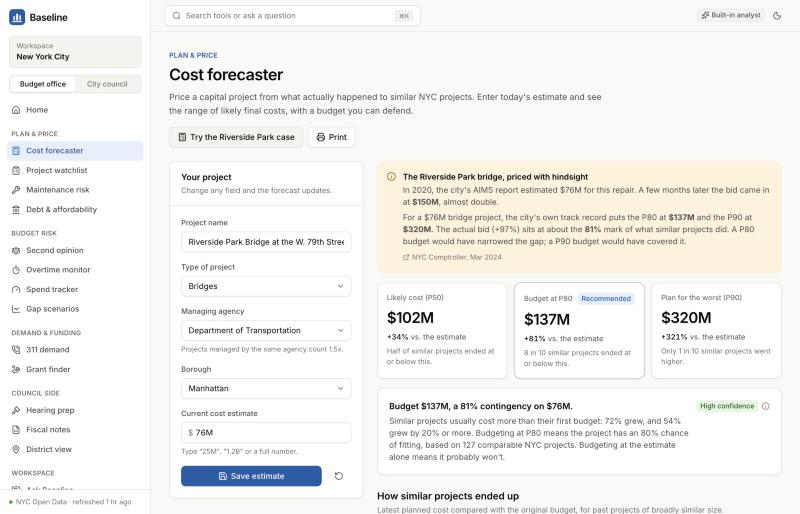
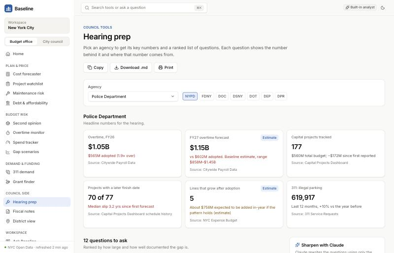

# Baseline

**One set of numbers for the budget office and the city council.**

Baseline is a budget and capital forecasting platform for city governments. It runs on a city's own open data and answers two questions every budget season fights over:

- **Budget office:** *How much will this really cost, and which lines will run over before the year ends?*
- **City council:** *Which of the mayor's numbers should we question, and what will this bill cost?*

Every number on screen links to its source. Forecasts are built from what similar projects and budget lines actually did, not from the plan.

**Live app:** https://jinghihong.github.io/baseline/

| | |
|---|---|
|  |  |
|  |  |

---

## Why this exists

New York City is the reference customer, because its problems are well documented:

- The city's asset survey (**AIMS**) estimated **$76M** to fix the Riverside Park bridge at W. 79th Street in 2020. The bid came in at **$149.9M**. Inspections are quick visual checks, and auditors found 57 unreported structural problems at 10 sampled assets. ([NYC Comptroller, Mar 2024](https://comptroller.nyc.gov/newsroom/audit-new-york-city-is-failing-to-accurately-identify-its-infrastructure-repair-needs/))
- Of 5,128 NYC capital projects, **64% were late** and **over half were over budget**, with planned spending **$54.5B above** initial budgets. ([NY State Comptroller, Apr 2024](https://www.osc.ny.gov/press/releases/2024/04/dinapoli-better-reporting-and-monitoring-nyc-capital-projects-needed))
- **80%** of Department of Design and Construction projects ran behind their original schedule, by **3.5 years on average**. The agency resets the baseline at each phase, which hides delays, and it has no system to forecast costs across its portfolio. ([NYC Comptroller audit SE23-073A, Dec 2025](https://comptroller.nyc.gov/wp-content/uploads/2026/02/SE23-073A.pdf))
- Overtime is budgeted far below what is spent: the Comptroller expects FY2027 overtime to exceed the adopted budget by **$589M**. ([NYC Comptroller, Aug 2026](https://comptroller.nyc.gov/reports/comments-on-new-york-citys-fiscal-year-2027-adopted-budget/))

Baseline's name is its promise: the first number the city publishes stays the baseline. Growth and delay are always measured from day one.

## What it does

| | Budget office | City council |
|---|---|---|
| **Capital** | Cost forecaster (P50/P80/P90 from the city's own project history), project watchlist, maintenance risk ranking, debt affordability | Watchlist of late and over-budget projects, district view |
| **Expense budget** | Overtime monitor, spend tracker (year-end projection from monthly actuals), lines that grow after adoption | Second opinion on chronically under-budgeted lines, Comptroller risk register, gap scenarios |
| **Oversight** | | Hearing prep (brief + data-backed questions), fiscal notes for proposed bills |
| **Demand & funding** | 311 demand forecasts, grant finder | 311 trends by district, grant finder |
| **Everywhere** | Ask Baseline (built-in analyst, or Claude with your own API key), printable reports, CSV import/export | Same |

## Data

All data is public and refreshed weekly by a GitHub Action ([`refresh-data.yml`](.github/workflows/refresh-data.yml)):

| Dataset | Source | Used for |
|---|---|---|
| Expense Budget (`mwzb-yiwb`) | NYC Open Data | Adopted vs modified budgets, overtime budgets |
| Citywide Payroll Data (`k397-673e`) | NYC Open Data | Overtime actually paid |
| Capital Project Detail Data (`wa2y-rh4b`, `s7yh-frbm`) | NYC Open Data | Reference class for cost forecasting (Oct 2023, the publication the State Comptroller reviewed) and the out-of-sample backtest (all 14 publications, 2019-2023) |
| Capital Projects Dashboard (`fb86-vt7u`, `95tx-snak`) | NYC Open Data | Live watchlist with budget and schedule history |
| 311 Service Requests (`erm2-nwe9`) | NYC Open Data | Demand trends and forecasts |
| City Council Capital Budget (`t474-a92g`) | NYC Open Data | District awards |
| Grants.gov Search API | Grants.gov | Open federal opportunities for city governments |

Published figures (Comptroller reports, audits) live in [`src/data/curated.ts`](src/data/curated.ts) with their citations.

## How the forecasts work

Short version (full detail on the in-app Methodology page and in [`docs/methodology.md`](docs/methodology.md)):

- **Capital cost:** reference-class forecasting. Similar past projects (same asset class, weighted by size, agency and borough) give a distribution of final cost ÷ original budget. Your estimate × that distribution = P50/P80/P90.
  - **Backtested out of sample:** trained only on April 2019 data and tested on 497 projects created later and since finished, 45% / 85% / 93% of final costs landed at or below P50 / P80 / P90 (targets 50 / 80 / 90). The city's original budget held for 40% of them; Baseline's P80 held for 85%. The Cost forecaster page reruns this test live.
- **Overtime:** damped-trend smoothing of actual overtime paid, compared with the adopted budget.
- **Under-budgeted lines:** each agency × object class is compared adopted vs modified over up to eight years; a line is flagged as chronic when it ends the year above adoption in at least 3 of every 4 years (5+ years of history), by a median of 20% or more.
- **311 demand:** seasonal index + linear trend with an 80% band.
- **Maintenance:** risk = probability of failure × consequence; a greedy optimizer funds the most risk reduction per dollar.

## AI

Baseline works fully without AI: a built-in analyst answers questions from the data. To use Claude, add your own Anthropic API key in **Settings**. The key stays in your browser and is sent only to the Anthropic API. Requests use `claude-opus-5-5` by default with server-side refusal fallback enabled.

## Run it locally

```bash
npm install
npm run dev
```

Other scripts:

```bash
npm run check      # type-check + unit tests
npm run build      # production build into dist/
npm run data       # refresh every dataset in public/data
```

Requires Node 22+.

## Project structure

```
scripts/            data pipeline (NYC Open Data + Grants.gov -> public/data/*.json)
public/data/        dataset snapshots served with the app
src/data/           dataset types, loaders, agency registry, cited published figures
src/engines/        forecasting and scoring logic (pure, unit-tested)
src/lib/            formatting, statistics, Claude client
src/components/     design system, charts, app shell
src/pages/          public site and app screens
docs/               research brief, methodology, architecture
```

See [`docs/architecture.md`](docs/architecture.md) for how the pieces fit.

## Deployment

Every push to `main` runs type-checks and tests, builds, and deploys to GitHub Pages ([`deploy.yml`](.github/workflows/deploy.yml)).

## Limits to keep in mind

- The expense budget data is all funds. In-year modifications include state and federal grants recognized during the year, so a line that grows is not always under-budgeted. Overtime (actual payroll) is the cleanest signal.
- Many capital projects in the reference data are mid-life; their final costs may grow further.
- The city sometimes reports one budget ID for several projects. Baseline marks those as shared and counts each budget once in totals.
- The maintenance screen ships with a clearly labeled sample asset register until a city imports its own.

## License

MIT
